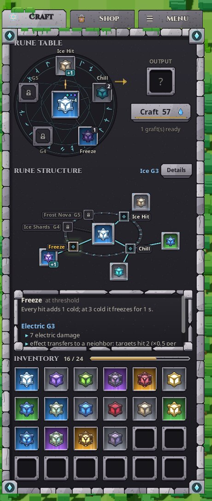
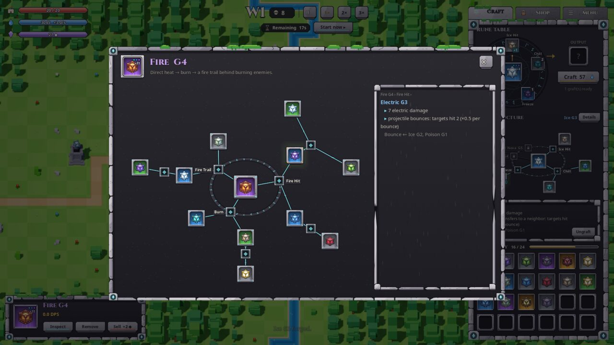

# RuneCraft MVP

A 3D voxel tower-defense prototype for Godot 4.7, viewed from a high orthographic angle.
- Build towers and socket runes, then defend the castle through escalating enemy waves.
- **Grades:** combine two equal runes to reach the next grade (G1–G5).
- **Grafting:** graft runes into each other's abilities without limit. A rule compiler resolves every combination.

Public prototype: the source is available for review, but **all rights are reserved** (there is no open-source licence
yet).

**Start here:**
- [docs/PROJECT_OVERVIEW.md](docs/PROJECT_OVERVIEW.md) — architecture, systems, state, gaps, open questions.
- [design/DECISIONS.md](design/DECISIONS.md) — current decisions; they override older documents.
- [TODO.md](TODO.md) — every request and its status (Turkish).
- [docs/PARITY_REPORT.md](docs/PARITY_REPORT.md) — Godot runtime vs. the Python reference.
- [docs/ECONOMY_STACKING.md](docs/ECONOMY_STACKING.md) — Mana economy, shop loops, status stacking.
- [docs/UI_REVIEW.md](docs/UI_REVIEW.md) — Craft tab, rune tree and inspector redesign with before / after captures.


| Craft tab | Rune inspector | Shop | Menu (paused) |
|---|---|---|---|
|  |  |  |  |

## Run

```sh
godot --path .                    # play (Godot 4.7, GL Compatibility)
bash tests/run.sh                 # headless invariant tests (1462 checks)
python3 design/rune_mechanics/mechanics/test_mechanics.py   # reference mechanics tests
```

Models, UI textures and fonts are loaded from `assets/` and `fonts/` at runtime, so no editor import step is needed.

## Controls

| Input | Action |
|---|---|
| WASD / arrows | pan the camera |
| Mouse wheel | zoom at the cursor |
| Middle drag | grab-pan |
| Q / E | rotate 90° |
| Space | pause |
| 1 / 2 / 3 | game speed (the simulation only; UI and camera stay real-time) |
| B or Shop → Build tower | build mode; Shift keeps building; right-click / Esc cancels |
| N or Start now | next wave |
| Drag and drop | move runes between inventory, craft table and towers; drop equal runes on each other to combine |
| Right-click a rune | open the rune inspector (the full radial graft tree); Esc / ✕ / click outside closes it |
| Tabs | Craft (rune table → rune structure → inventory), Shop (build tower + runes, prices grow with purchases), Menu (pauses the game; resume, settings incl. language, save between waves, load, quit) |
| Rune structure | click an ability or donor in the tree to read what it does; hover previews; *Details* opens the inspector |

## Features

- **Random maps.** Every map has a meandering river with a bridge, plateaus with stairs, rocks and forests. A
  decorative forest apron keeps the camera from seeing the void.
- **Grid-based play.** Towers, ranges (shown as cells), ground fields and summons all snap to the grid.
- **Runes.**
  - 13 runes, including the economy-focused Mana rune.
  - Each grade unlocks one distinct ability.
  - The graft compiler supports unlimited nesting, with budgets that prevent runaway chains.
- **Economy.**
  - Mana regenerates and comes from kills and the Mana rune; it buys runes and pays combine and graft fees.
  - Mana stones come from kills and pay for towers.
  - Shop prices grow multiplicatively. The numbers are provisional.
- **Safety.**
  - Rune moves are transactional: no rune is ever lost or duplicated.
  - Saves are versioned and validated. Saving is allowed between waves only.
- **UI.**
  - A carved-stone HUD designed in Penpot and exported at 2×.
  - Runes are read as a **radial stone tree**: the main rune in the middle, abilities on a glyph ring, donors
    branching outward through carved grooves.
  - **Grade reads like loot rarity** (grey, green, blue, purple, gold light behind the rune); rune icons are renders
    of the 3D runes.
  - English and Turkish UI.

## Layout

| Path | Contents |
|---|---|
| `scripts/` | Game logic: hub, rune store, economy, save system, map generator, world, camera, combat, towers, enemies, VFX |
| `ui/` | HUD, craft table, slots, rune inspector, Penpot texture skin |
| `data/` | Rune mechanics spec (JSON) and rune colours |
| `assets/` | Runtime GLBs (tiles, props, runes, units, summons) and UI PNGs. The `.vox` sources are **not** in this repo |
| `tests/` | Headless invariant suite; `tests/ui/` UI interaction and layout checks (real renderer) |
| `tools/` | Rune icon renderer |
| `design/` | Decisions, rune mechanics design, Python reference implementation + tests + reports, historical GDD and briefs |
| `docs/` | Project overview, parity report, screenshots |
| `ui_design/` | Penpot-side generator script and the export pull script |

## Penpot UI pipeline

- **Design.** All UI art is designed in Penpot (page "HUD v3 · Stone"). Boards named `rcui / <name>` are exported at
  2× and uploaded as media `rcui__<name>`.
- **Pull.** `ui_design/pull_penpot_exports.sh` copies them into `assets/ui/`; `ui_design/pull_penpot_sheets.sh` cuts
  whole exported kit sheets (faster).
- **Requirements.** Refreshing the textures needs the Penpot file and a local Penpot instance.

## Credits

- Fonts: Noto Sans and Cinzel, under the SIL Open Font License. The licence texts are in `fonts/`.
- Voxel assets were made for this project.
