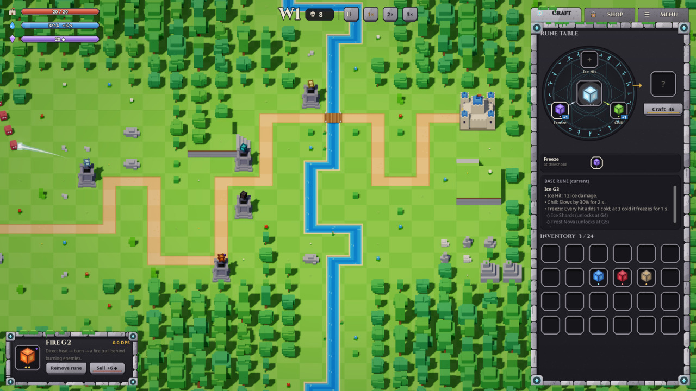
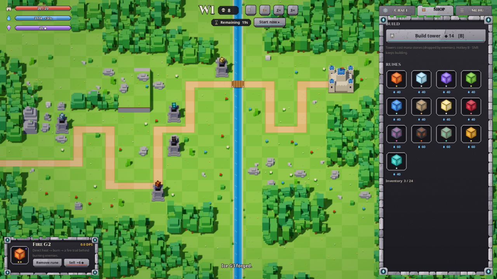
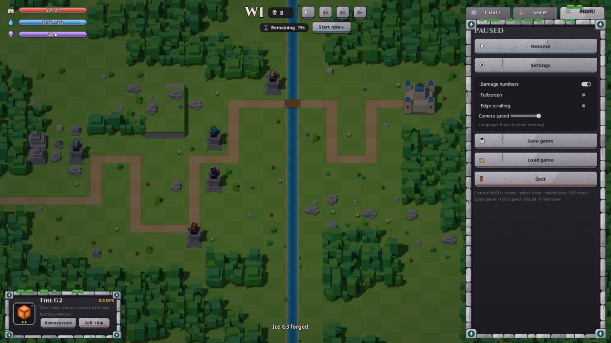

# RuneCraft MVP

Private prototype — all rights reserved.

RuneCraft is a voxel tower-defense prototype for Godot 4. Build towers, socket
runes and defend a castle through escalating enemy waves.



| Shop | Menu (paused) |
|---|---|
|  |  |

## Run

Install Godot 4, then run from the repository root:

```sh
godot --path .
```

You can also import `project.godot` in the Godot editor and run the main scene.
Keep `assets/` and `fonts/` beside the project: models, UI textures and fonts are
loaded directly from files at runtime.

## Controls

- Camera: WASD / arrows to pan; mouse wheel to zoom at the cursor;
  middle-drag to grab the map; Q / E to rotate.
- Space pauses; 1 / 2 / 3 set simulation speed; B toggles building;
  N calls the next wave. Click to place/select; Shift keeps building;
  right-click or Escape cancels building/selection.
- Drag and drop runes between inventory, crafting slots and towers.
  Drop matching runes together to combine grades.
- Craft / Shop / Menu tabs provide crafting, purchases and save/load/settings.
  Opening Menu pauses the simulation.

## Features

- Seeded random maps with a river and bridge, plateau, rocks and a forest apron.
- Grid-based towers, targeting ranges and ground fields, with high-ground bonuses.
- Thirteen rune types, grades G1–G5 and an event-graft craft compiler that composes
  effects through ability slots.
- Mana and mana stone economy, enemy waves, castle health and combat VFX.
- English UI with a localisation-ready rune library and English/Turkish tables.
- Save/load, fullscreen, damage numbers and camera settings.

## Layout

- `project.godot`, `main.tscn`: project configuration and entry scene.
- `scripts/`: map, camera, waves, combat, towers and rune compiler;
  `scripts/locale/`: rune-library translations.
- `ui/`, `shaders/`: HUD controls, texture skin and post-processing.
- `assets/{tiles,props,runes,summons,units}/`: runtime voxel GLBs;
  `assets/ui/`: Penpot texture exports.
- `data/`: mechanics, rune colours and prop metadata; `fonts/`: fonts and licences.
- `ui_design/`: Penpot design script and export pull script; `TODO.md`: prototype work.

## Penpot UI pipeline

The UI is designed in Penpot on page **HUD v3 · Stone**. Boards named
`rcui / *` are exported at **2×** and pulled into `assets/ui/` with
`ui_design/pull_penpot_exports.sh`. `ui_design/penpot_stone_v4.js` documents the
design construction. Existing PNG exports are sufficient to run the game;
refreshing them requires the corresponding Penpot file and export setup.

## Credits and status

Noto and Cinzel fonts are distributed under the SIL Open Font License (OFL).
Retain their copyright and licence texts with the fonts. Voxel assets were made
for this project. Third-party font terms remain applicable.

**Private prototype — all rights reserved.** This repository grants no general
licence to copy or redistribute the game or its project assets.
