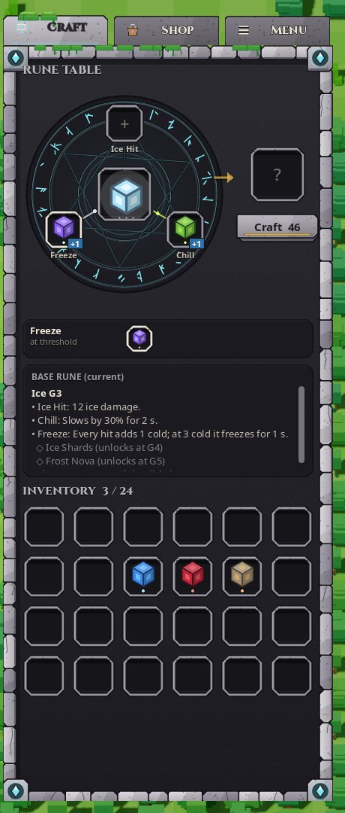
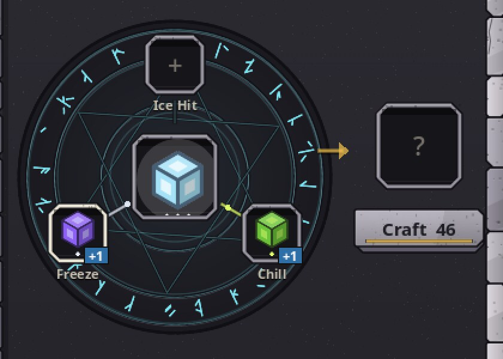
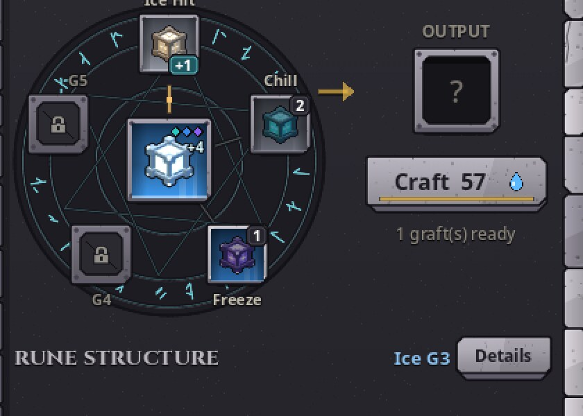
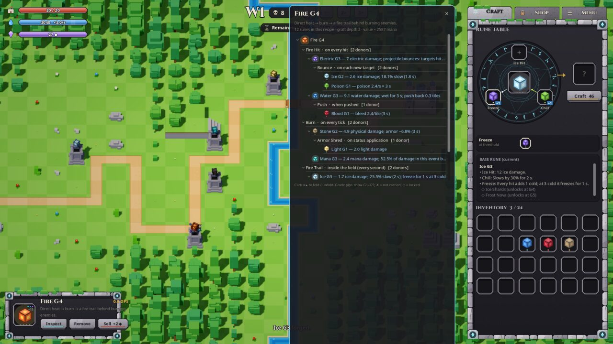
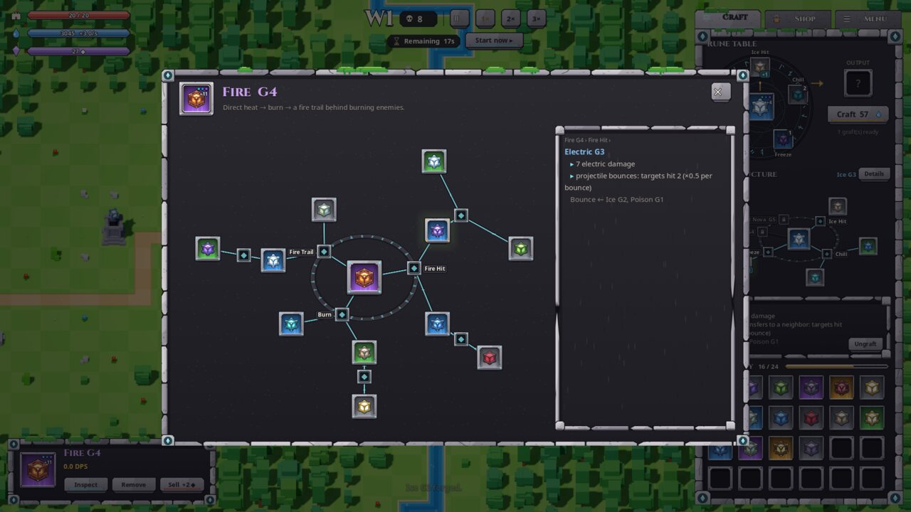

# Craft UI, rune structure and inspector — review (2026-10-31)

Goal: make the rune system readable with less effort, in the existing carved-stone style. All art comes from Penpot
(page "HUD v3 · Stone", boards `Kit v5 · craft & inspector · export`) except the rune icons, which are renders of
the in-game 3D runes (`tools/render_rune_icons.gd`).

## What changed

| Area | Before | After |
|---|---|---|
| Craft tab order | table → text box → inventory | **crafting → rune structure → inventory**; inventory always fully visible |
| Circles behind square slots | G3+ rune icons had a grey round halo baked in; a round glow and two rings sat behind / through the sockets | halo removed in Penpot, round glow replaced by a square light, rings removed; the big magic circle and the craft animation stay |
| Slots | chamfered rims with speckles, one look for every state | carved stone sockets, one rim accent per state: normal, hover, selected, **drop**, **invalid** (red, while a drag cannot land), output, **pending** (dashed), **locked** (sealed stone) |
| Grade | 1–5 small dots under the cube | **loot rarity light** filling the slot: grey G1, green G2, blue G3, purple G4, gold G5 (sparkles from G4) |
| Rune icons | flat drawn cubes | renders of the real voxel runes: 3/4 view, key / fill / rim light, bloom, carved outline |
| Locked abilities | not shown on the table | shown as sealed sockets with their unlock grade; a drop there is refused visibly |
| Craft button | "Craft 46", no reason when disabled | Craft + mana icon + fee; one status line (needs a base / a graft / N mana / ready) |
| Rune information | a long text block | **radial stone tree**: main rune in the middle, abilities on a glyph ring, donors branching out through carved grooves (lit when they carry something), nested donors further out. Click = pick, hover = preview. A short stone caption under it. No metadata subtitles |
| Inspector | 660 px text tree at the right edge | **centred floating stone panel**: the whole tree (every nested graft) + a detail plaque with the picked node's path and effects |
| Tooltip | long description, could grow off-screen | loot-style: name in its grade colour, one identity line, abilities that carry grafts (≤ 4), locked list, "right-click: details"; always on screen, never covers its slot, hidden while the inspector is open |
| Tower card | name and DPS could overflow | name with ellipsis, DPS and mana/s on their own row, three equal buttons; nothing leaves the card |
| Text | English literals | `scripts/locale/{en,tr}.json` → `ui` (105 keys); Settings → Language |

The compact tree and the inspector are the same model at two depths: the Craft tab answers "what does this rune
do and which donor feeds which ability" (abilities + direct donors, a "+N" badge marks nested grafts); the
inspector answers "everything in this recipe" (all levels, uncarried effects, the path of each node).

Crafting still has **no result preview**: donors waiting on the table appear as pending nodes, and their effect is
described only after crafting.

## Inspector behaviour

| Situation | Behaviour (tested) |
|---|---|
| Open | right-click any rune, *Inspect* on the tower card, *Details* in the Craft tab |
| Close | ✕, Esc, or a click outside the panel; that click does not reach the tab or world underneath |
| World input | blocked (veil); hotkeys swallowed except Space / 1 / 2 / 3 |
| Pause | the game keeps running (chosen so the inspector never fights the Menu pause or the player's own pause) |
| Tower's rune swapped | the inspector follows the new rune |
| Rune removed / tower sold / rune consumed by combine or craft | closes |
| Rune edited in place (ungraft on the table) | rebuilds |
| Load | closes (the loaded game owns new rune objects) |

## Verification

`tests/ui/run_ui.gd` runs with a real renderer and pushes synthetic mouse and key events through Godot's normal
input path (hover, press, motion with the button held → Godot's drag and drop, release, right-click, Esc). 66
checks per configuration: all 24 inventory slots on screen; Craft tab order without overlap; compact and full tree
without overlapping or out-of-area nodes (a 17-rune, 3-level recipe); nothing overflows the Craft / Shop / Menu
pages or the tower card; tooltips on screen in four corners; drag to base, to an ability, to a locked socket (red
state, no change), combine, swap, take back a pending donor, double-click to socket; every inspector case above;
tree pick / hover / Details.

| Configuration | Result |
|---|---|
| 1280×720 EN | 66/66 |
| 1366×768 EN | 66/66 |
| 1920×1080 EN | 66/66 |
| 2560×1080 (21:9) EN | 66/66 |
| 1440×1080 (4:3) EN | 66/66 |
| 1280×720 TR | 66/66 |
| 1440×1080 TR | 66/66 |

All seven runs: 0 script errors. Camera 45° / 30° / zoom-based: the UI captures run without errors
(`ui/after_cam30.jpg`, `ui/after_camdyn.jpg`).

Not covered: a human with a physical mouse (feel, timing, precision). At 1280×720 the whole 1920×1080 layout is
scaled to 2/3, so 13 px design text is about 9 px on screen.

## Captures

| Before | After |
|---|---|
|  |  |
|  |  |
|  |  |

More: `ui/after_tooltip.jpg`, `ui/after_720_tr.jpg`, `ui/after_4x3_inspector.jpg`, `ui/after_21x9.jpg`,
`ui/after_cam30.jpg`, `ui/after_camdyn.jpg`.
